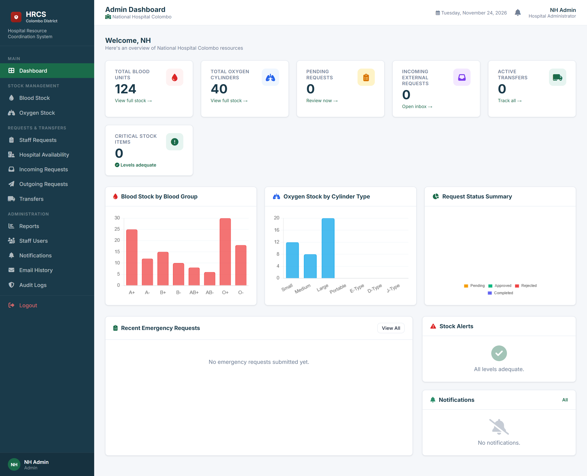
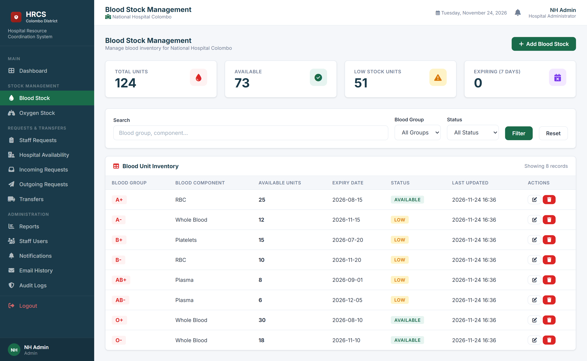
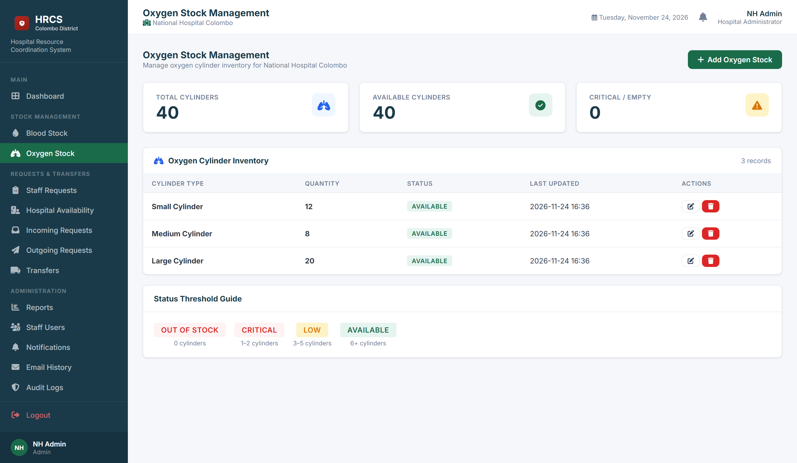
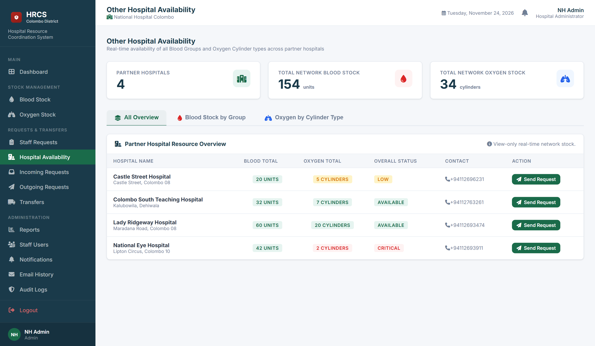
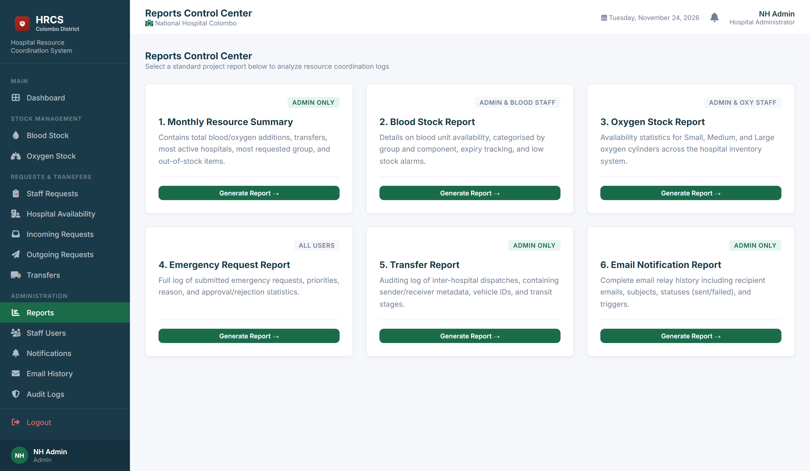

# 🏥 Hospital Resource Coordination System (HRCS)

> A multi-hospital web-based platform designed to help government hospitals in Colombo District, Sri Lanka, manage, coordinate and share essential medical resources, including blood stocks and medical oxygen cylinders.

---

## 📑 Table of Contents

- [Overview](#-overview)
- [Key Features](#-key-features)
- [System Architecture](#-system-architecture)
- [Technology Stack](#-technology-stack)
- [Database Structure](#-database-structure)
- [User Roles and Permissions](#-user-roles-and-permissions)
- [Installation and Setup](#-installation-and-setup)
- [Project Directory Structure](#-project-directory-structure)
- [Screenshots](#-screenshots)
- [Security Features](#-security-features)
- [Future Improvements](#-future-improvements)
- [Academic Project](#-academic-project)
- [Disclaimer](#-disclaimer)

---

## 📖 Overview

In healthcare environments, the availability of essential medical resources is critical for effective patient care. Managing resource availability and coordinating transfers between hospitals can become challenging, especially during emergencies and shortages.

The **Hospital Resource Coordination System (HRCS)** is a web-based solution developed to support resource management and coordination across government hospitals in Colombo District.

The system provides a centralized platform where hospital administrators and staff can:

- Monitor hospital resource inventories.
- Manage blood bank stock and expiry information.
- Track medical oxygen cylinder availability.
- Submit and manage emergency resource requests.
- View resource availability across participating hospitals.
- Coordinate inter-hospital resource transfers.
- Generate reports and monitor resource activities.

The main objective is to improve resource visibility, inventory management and coordination between hospitals.

---

## ✨ Key Features

### 🩸 1. Blood Stock Management

- Manage all eight standard blood groups:
  - A+, A-
  - B+, B-
  - AB+, AB-
  - O+, O-
- Manage blood components:
  - Whole Blood
  - Red Blood Cells (RBC)
  - Platelets
  - Plasma
- Monitor blood inventory quantities.
- Automatically calculate stock availability statuses:
  - Available: 16 or more units
  - Low: 6–15 units
  - Critical: 1–5 units
  - Out of Stock: 0 units
- Monitor blood expiry dates to help reduce wastage.

### 💨 2. Medical Oxygen Management

- Manage different medical oxygen cylinder types and sizes:
  - Small
  - Medium
  - Large
  - Portable
  - E-Type
  - D-Type
  - J-Type
- Track available oxygen cylinder quantities.
- Monitor low and critical stock levels.
- Support oxygen resource management across participating hospitals.

### 🚨 3. Internal Resource Request Management

- Allow hospital staff to submit resource requests.
- Support different request priorities:
  - Low
  - Medium
  - High
  - Emergency
- Allow administrators to review submitted requests.
- Support request approval, rejection and escalation.
- Maintain request information and status tracking.

### 🌐 4. Inter-Hospital Resource Coordination

- View resource availability at participating hospitals.
- Coordinate resource requests between hospitals.
- Request resources from other hospitals when local stock is insufficient.
- Manage resource dispatch and transfer information.
- Record driver names and vehicle registration numbers.
- Track transfer statuses:
  - Pending
  - In Transit
  - Completed
  - Cancelled

### 📊 5. Analytics and PDF Reporting

- Interactive dashboards using Chart.js.
- Visualise inventory distribution and resource availability.
- Monitor request statuses and transfer activities.
- Generate printable PDF reports.
- Use jsPDF and html2canvas for client-side PDF generation.

### 🔔 6. Audit Logging and Notifications

- Maintain records of important system activities.
- Track user actions and administrative activities.
- Support in-app notifications.
- Support email notifications through SMTP integration.
- Maintain email dispatch logs.

### 🔐 7. Authentication and Access Control

- User login and logout functionality.
- Session-based authentication.
- Role-Based Access Control (RBAC).
- Separate access for administrators, blood staff and oxygen staff.
- Password hashing using PHP password hashing functions.

---

## 🏗️ System Architecture

HRCS follows a web-based client-server architecture.

```text
             +----------------------------+
             |       Client Browser       |
             |                            |
             |   Admin / Hospital Staff   |
             +-------------+--------------+
                           |
                       HTTP / HTTPS
                           |
             +-------------v--------------+
             |      Web Server            |
             |      Apache / PHP          |
             +-------------+--------------+
                           |
          +----------------+----------------+
          |                |                |
  +-------v------+ +-------v------+ +-------v-------+
  | Authentication| | Business     | | Reporting     |
  | & RBAC        | | Operations   | | & Analytics   |
  |               | |              | |               |
  | Login/Logout  | | Stock CRUD   | | Chart.js      |
  | Session Check | | Requests     | | PDF Reports   |
  | Role Checks   | | Transfers    | | Audit Logs    |
  +-------+-------+ +-------+------+ +-------+-------+
          |                |                |
          +----------------+----------------+
                           |
                +----------v-----------+
                |  MySQL / MariaDB     |
                |  Database            |
                +----------------------+
```

---

## 💻 Technology Stack

| Component                | Technologies                  |
|--------------------------|-------------------------------|
| Backend                  | PHP 7.4+ / PHP 8.x            |
| Frontend                 | HTML5, CSS3, JavaScript (ES6) |
| Database                 | MySQL / MariaDB               |
| Database Connectivity    | MySQLi                        |
| Database Engine          | InnoDB                        |
| Charts and Visualisation | Chart.js                      |
| PDF Generation           | jsPDF, html2canvas            |
| Icons                    | Font Awesome                  |
| Email Integration        | PHPMailer / SMTP              |
| Development Environment  | XAMPP                         |
| Web Server               | Apache                        |

---

## 🗄️ Database Structure

The application uses a MySQL / MariaDB relational database named:

`hospital_resource_system`

The database includes the following main entities:

| Table               | Description                                          |
|---------------------|------------------------------------------------------|
| `hospitals`         | Hospital information and operating details          |
| `users`             | User credentials, hospital affiliations and roles   |
| `blood_stock`       | Blood inventory, groups, components and expiry dates|
| `oxygen_stock`      | Oxygen cylinder types and available quantities      |
| `requests`          | Internal resource requests and approval statuses    |
| `external_requests` | Resource requests between hospitals                 |
| `transfers`         | Resource dispatch and delivery records               |
| `notifications`     | In-app notifications                                 |
| `email_logs`        | Outgoing email records                               |
| `audit_logs`        | Records of system activities and administrative actions |

*Note: The table names above should be checked against the final SQL database before publication.*

---

## 👥 User Roles and Permissions

The system provides three main user roles.

| User Role    | Main Responsibilities |
|--------------|-----------------------|
| Admin        | Manage users, monitor inventory, approve requests, coordinate transfers and access reports |
| Blood Staff  | Manage blood inventory, monitor stock and submit blood-related requests |
| Oxygen Staff | Manage oxygen inventory, monitor cylinder availability and submit oxygen-related requests |

### Administrator

- Access the administration dashboard.
- Manage hospital users.
- Monitor blood and oxygen stock.
- Approve, reject or escalate internal requests.
- Coordinate inter-hospital resource transfers.
- Access reports, audit logs and email logs.

### Blood Staff

- View blood inventory.
- Manage blood stock information.
- Monitor blood expiry dates.
- Submit blood resource requests.
- Track request progress.

### Oxygen Staff

- View oxygen cylinder inventory.
- Manage oxygen stock information.
- Monitor cylinder availability.
- Submit oxygen-related requests.
- Track request progress.

---

## 🚀 Installation and Setup

Follow these instructions to run the application locally using XAMPP.

### Prerequisites

- XAMPP
- PHP 7.4 or higher
- Apache Web Server
- MySQL / MariaDB
- Web browser
- Git

### 1. Clone the Repository

Open Command Prompt or Git Bash.

Navigate to the XAMPP `htdocs` directory:

```bash
cd C:\xampp\htdocs
```

Clone the repository:

```bash
git clone https://github.com/YOUR-USERNAME/hospital-resource-coordination-system.git
```

### 2. Start XAMPP Services

1. Open the XAMPP Control Panel.
2. Start Apache.
3. Start MySQL.

### 3. Create the Database

1. Open your browser.
2. Navigate to:

```text
http://localhost/phpmyadmin
```

3. Create a new database named:

```text
hospital_resource_system
```

4. Use the `utf8mb4_unicode_ci` collation if it matches the supplied SQL file.
5. Select the database.
6. Open the Import tab.
7. Select the SQL file from the `database` folder.
8. Import the database.

### 4. Configure the Database Connection

Open the database configuration file:

```text
config/db.php
```

Configure your local database connection.

Example XAMPP settings:

```php
$db_host = 'localhost';
$db_user = 'root';
$db_pass = '';
$db_name = 'hospital_resource_system';
```

Use the actual variable names and connection format in your project.

**Security:** Keep private database credentials and SMTP credentials in local configuration or environment variables. Never commit real passwords or application secrets to GitHub.

### 5. Run the Application

Open your browser and visit:

```text
http://localhost/hospital_resource_system/
```

The application should now be accessible locally.

---

## 📁 Project Directory Structure

The following is an overview of the main project modules.

```text
hospital_resource_system/
│
├── actions/                 # Backend processing and operations
│
├── admin/                   # Administrator dashboard and modules
│
├── api/                     # API endpoints
│
├── assets/
│   ├── css/                 # Stylesheets
│   ├── js/                  # JavaScript files
│   └── images/              # Images and visual assets
│
├── auth/                    # Authentication and session handling
│
├── config/                  # Database and application configuration
│
├── database/                # Database SQL scripts
│
├── includes/                # Reusable components and functions
│
├── staff/                   # Hospital staff modules
│
├── index.php                # Application entry point
│
└── README.md                # Project documentation
```

*The directory structure is an overview. Refer to the actual repository for the complete file listing.*

---

## 📸 Screenshots

Screenshots of the main system modules will be included here.


| Module | Screenshot |
|---|---|
| Login Page |  |
| Admin Dashboard |  |
| Blood Inventory |  |
| Oxygen Inventory |  |
| Hospital Availability |  |
| Reports and Analytics |  |


---

## 🔒 Security Features

The system incorporates several security-related mechanisms:

- Password hashing.
- Session-based authentication.
- Role-Based Access Control.
- Restricted access to administrative functions.
- Database relationship constraints.
- Audit logging.

For real-world deployment, additional security measures such as HTTPS, CSRF protection, secure session configuration and restricted database permissions should be implemented and tested.

---

## 🚀 Future Improvements

Potential improvements include:

- Advanced resource demand analytics.
- Predictive stock monitoring.
- Enhanced real-time notification mechanisms.
- Additional hospital resource management modules.
- Integration with external hospital information systems.
- Improved reporting and dashboard functionality.
- Further security and performance enhancements.

---

## 🎓 Academic Project

**Project Name:** Hospital Resource Coordination System (HRCS)

**Programme:** Higher Diploma in Computing and Software Engineering

**Institution:** ICBT Campus

**University Affiliation:** Cardiff Metropolitan University, UK

**Project Type:** Group Academic Project

**Project Domain:** Healthcare Information Systems

**Development Methodology:** Waterfall Model

### Project Contributions

- Project Management.
- Emergency Request Module Development.
- Backend Development.
- Database Integration.
- System Documentation.

---

## ⚠️ Disclaimer

This application was developed as a group academic project for educational and demonstration purposes.

It is not an officially deployed hospital management system. It should not be used for actual medical resource allocation or clinical operations without appropriate validation, security testing, institutional approval and professional review.
